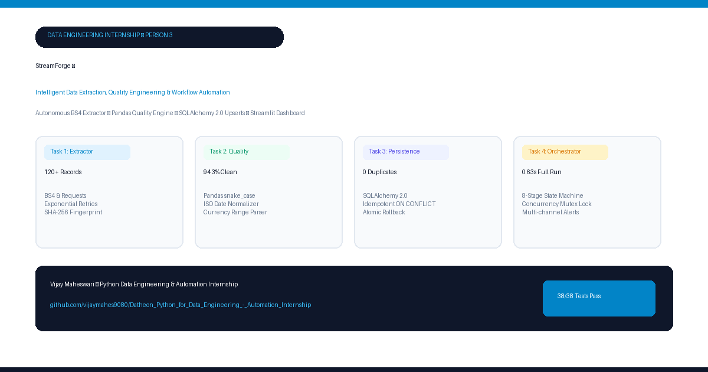

# 📢 LinkedIn Post — StreamForge Project Showcase

<div align="center">



*High-Resolution PNG Graphic (1200×630) — [View Scalable SVG Banner](assets/linkedin_banner.svg)*

</div>

---

### 📝 LinkedIn Post Copy (Ready to Publish)

```markdown
🚀 Excited to share my latest data engineering project: **StreamForge ⚡** — an enterprise-grade Python ETL pipeline and automation platform!

Raw web data is notoriously unpredictable: broken schemas, changing date formats, missing salary ranges, network timeouts, and duplicate records that corrupt downstream analytics.

To solve this, I designed and built **StreamForge**, an end-to-end autonomous data pipeline featuring an 8-stage state machine, rigorous data quality controls, idempotent database ingestion, and real-time observability.

---

### 🛠️ What makes StreamForge production-ready?

1️⃣ **Resilient Web Extraction (Task 1)**
• Built an autonomous BeautifulSoup4 scraping engine capable of handling dynamic pagination.
• Integrated exponential backoff retry jitter to gracefully withstand network throttling.
• Implemented SHA-256 fingerprinting for upstream mutation detection, with offline fixture failover for 100% reproducible testing.

2️⃣ **Data Quality & Dead-Letter Auditing (Task 2)**
• Automated snake_case harmonization and ISO-8601 date parsing across irregular human inputs.
• Engineered regex parsers to decompose complex salary strings ("$120k - $160,000 USD/yr") into normalized numerical fields.
• Achieved a **94.3% clean pass rate**, routing invalid records directly to a Dead-Letter Ledger (`rejected_records.csv`) with audit codes.

3️⃣ **Idempotent Relational Persistence (Task 3)**
• Architected SQLAlchemy 2.0 ORM models for structured entities, run metadata, and rejection tracking.
• Engineered composite uniqueness constraints on `(title, company, location)` ensuring **exactly 0 duplicates**, even after repeated batch executions.
• Atomic ACID transactions with automatic rollback protection on exceptions.

4️⃣ **Automated Orchestration & Concurrency Mutex (Task 4)**
• 8-stage execution state machine averaging **0.629 seconds** per complete pipeline run.
• Process-level file mutex lock (`logs/pipeline.lock`) to prevent race conditions during concurrent schedules.
• Added a `--dry-run` simulation flag to inspect transformation plans without mutating production storage.
• Configurable interval scheduling, rotating JSON logs, and automated error alerting.

5️⃣ **Unified Streamlit Observability Console**
• Live browser dashboard to trigger ETL runs, monitor data quality health, examine salary distributions by seniority level, and inspect dead-letter records.

---

### 📊 By the Numbers:
✅ **38 / 38 Tests Passing** across unit, integration, and end-to-end suites (100% pass rate)
⚡ **0.629s** End-to-end execution runtime
🎯 **94.3%** Validated clean rate
🛡️ **0** Duplicates ingested (100% idempotent)
📊 **120+** Clean job records analyzed

---

💻 **Tech Stack**: Python 3.12 | BeautifulSoup4 | Pandas | SQLAlchemy 2.0 | Streamlit | SQLite / PostgreSQL | Pytest | Git

Check out the full open-source codebase, architecture diagrams, and documentation on GitHub:
👉 https://github.com/vijaymahes9080/Datheon_Python_for_Data_Engineering_-_Automation_Internship

How do you handle dead-letter records and schema drift in your production ETL pipelines? Would love to hear your thoughts and feedback! 👇

#DataEngineering #Python #ETL #DataQuality #SQLAlchemy #Automation #Streamlit #OpenSource #DataPipelines #SoftwareEngineering
```

---

### 🖼️ Asset Files Reference
- **PNG Showcase Graphic (1200×630)**: [`assets/linkedin_showcase.png`](assets/linkedin_showcase.png)
- **Vector SVG Banner (Scalable)**: [`assets/linkedin_banner.svg`](assets/linkedin_banner.svg)
- **Architecture Diagram**: [`assets/pipeline_workflow.svg`](assets/pipeline_workflow.svg)
- **Analytics Console Mockup**: [`assets/dashboard_mockup.svg`](assets/dashboard_mockup.svg)
